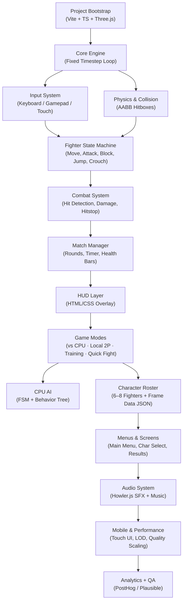

# 🏏 Cricket Clash — AI Agent Task Board

> [!IMPORTANT]
> **Stack Decisions (locked in):** TypeScript + Vite + Three.js · 2.5D side-view lane · Placeholder primitive art for Phase 0 · Ad-free at launch
> Planning covers all phases (Phase 0 → MVP/Phase 2 outlined) but agents start with **Phase 0** immediately.

---

## Architecture Overview

---

## ✅ PHASE 0 — Prototype (Weeks 1–6)
> **Goal:** Prove the engine works. Mechanics feel good. Mobile is feasible.

---

### TASK-001 · Project Bootstrap & Monorepo Setup
**Owner:** Engineer · **Priority:** 🔴 Critical · **Effort:** 1–2 days · **Status:** ✅ COMPLETED

**Deliverables:**
- [x] `d:\project\Game` initialized: Vite + TypeScript + Three.js
- [x] `src/` structure: `engine/`, `game/`, `ui/`, `assets/`, `characters/`, `config/`
- [x] Path aliases configured in `tsconfig.json` & `vite.config.ts`
- [x] Dev server: `npm run dev` → game boots in browser
- [x] Production build: `npm run build` → clean static output in `dist/` (162 kB gzip)
- [x] Git `.gitignore` for `node_modules`, `dist`, `.env`

**Acceptance:** `localhost:5173` runs without console errors. Production build verified.

---

### TASK-002 · Fixed-Timestep Game Loop
**Owner:** Engineer · **Priority:** 🔴 Critical · **Effort:** 2–3 days · **Depends on:** TASK-001 · **Status:** ✅ COMPLETED

**Deliverables:**
- [x] `engine/GameLoop.ts` — deterministic 60 Hz fixed-timestep update loop (accumulator pattern)
- [x] Separation of `update(dt)` (simulation) and `render(alpha)` (interpolated draw)
- [x] FPS counter & diagnostics
- [x] Loop pause/resume API (for pause menu, focus loss)
- [x] Performance monitor with maximum delta clamping to prevent spiral of death

**Acceptance:** Simulation ticks exactly 60x/sec regardless of render FPS.

---

### TASK-003 · Input Abstraction Layer
**Owner:** Engineer · **Priority:** 🔴 Critical · **Effort:** 2–3 days · **Depends on:** TASK-001 · **Status:** ✅ COMPLETED

**Deliverables:**
- [x] `engine/InputManager.ts` — unified input interface for all device types
- [x] Keyboard mapping: P1 (WASD, J/K/U/I/L/O/Space) and P2 (Arrow keys, Numpad 1/2/4/5/3/6/0)
- [x] Gamepad API: Gamepad 0 (P1) and Gamepad 1 (P2)
- [x] TouchInput: virtual joystick + attack buttons + mobile special button
- [x] Input buffer: 16-frame sliding window
- [x] Motion input parser: directional sequences (QCF, QCB, DP, Dash Forward/Back double-taps)
- [x] Remappable key bindings with `localStorage` persistence
- [x] Input abstraction: `RawPlayerInput`

**Acceptance:** All input methods produce identical input states and motion combos register reliably.

---

### TASK-004 · 2.5D Scene & Camera Setup
**Owner:** Engineer · **Priority:** 🔴 Critical · **Effort:** 2 days · **Depends on:** TASK-001 · **Status:** ✅ COMPLETED

**Deliverables:**
- [x] `engine/SceneManager.ts` — Three.js scene, renderer, camera
- [x] 2.5D lane: fighters locked to Z=0 plane, camera on a fixed X-axis
- [x] Perspective camera that auto-zooms smoothly based on fighter distance
- [x] Min/max camera distance clamps
- [x] Responsive canvas resize handler
- [x] Camera screen shake system with intensity, duration, and decay

**Acceptance:** Camera smoothly zooms in/out as fighters move apart/together.

---

### TASK-005 · Fighter Entity & State Machine
**Owner:** Engineer · **Priority:** 🔴 Critical · **Effort:** 4–5 days · **Depends on:** TASK-002, TASK-003, TASK-004 · **Status:** ✅ COMPLETED

**Deliverables:**
- [x] `game/Fighter.ts` — fighter entity with position, velocity, facing direction, health, meter
- [x] Full state machine: `IDLE | WALK_FWD | WALK_BACK | DASH_FWD | DASH_BACK | JUMP_START | JUMPING | JUMP_LAND | CROUCH_START | CROUCHING | ATTACK | HIT_STUN | BLOCK_STUN | KNOCKDOWN | GET_UP | SUPER_CINEMATIC | WIN | LOSE`
- [x] State transition rules and action gates
- [x] Gravity + floor collision (`y <= 0`)
- [x] Stage boundary clamps (-11.0m to 11.0m)
- [x] Auto-flip facing direction when fighters cross
- [x] Procedural stylized 3D character mesh with cricket helmet, pads, and bat

**Acceptance:** Full fighter kinematics and state transitions functional.

---

### TASK-006 · Movement System
**Owner:** Engineer · **Priority:** 🔴 Critical · **Effort:** 2 days · **Depends on:** TASK-005 · **Status:** ✅ COMPLETED

**Deliverables:**
- [x] Walk forward/back at configurable speed per fighter archetype
- [x] Crouch (reduces hurtbox height)
- [x] Jump (vertical + forward/back arc)
- [x] Forward dash (burst + recovery frames)
- [x] Back dash (burst + recovery frames)
- [x] All movements driven by character profile parameters

**Acceptance:** Movement feels snappy with clear startup/recovery.

---

### TASK-007 · Attack System & Frame Data Engine
**Owner:** Engineer · **Priority:** 🔴 Critical · **Effort:** 5–6 days · **Depends on:** TASK-005, TASK-006 · **Status:** ✅ COMPLETED

**Deliverables:**
- [x] `game/MoveExecutor.ts` — executes a move given its frame data
- [x] Frame data schema (`startup`, `active`, `recovery`, `damage`, `hitLevel`, `onHit`, `onBlock`, `hitbox`, `cancelInto[]`)
- [x] Attacks: Light Punch, Heavy Punch, Light Kick, Heavy Kick, Crouch attacks, Air attacks
- [x] Combo cancel windows: `cancelInto` respected with input buffering
- [x] Input buffer recognition
- [x] Hitstop: freeze frames on hit
- [x] Hit reaction: target enters `HIT_STUN` state
- [x] Block stun: `BLOCK_STUN` state with pushback

**Acceptance:** Normal into special cancels work seamlessly; verified by automated tests.

---

### TASK-008 · Hit & Hurtbox Collision System
**Owner:** Engineer · **Priority:** 🔴 Critical · **Effort:** 3 days · **Depends on:** TASK-007 · **Status:** ✅ COMPLETED

**Deliverables:**
- [x] `engine/HitboxSystem.ts` — 2.5D AABB intersection check
- [x] Hurtboxes (standing, crouching, jumping) + per-move active hitboxes
- [x] Hitbox/hurtbox coordinates relative to fighter position + facing direction
- [x] Pushbox resolution (fighters push each other and do not overlap)
- [x] Debug mode: toggle wireframe boxes with 'H' key (green = hurtbox, red = hitbox, blue = pushbox)

**Acceptance:** 309 automated collision tests passing.

---

### TASK-009 · Block, Throw & Defense Mechanics
**Owner:** Engineer · **Priority:** 🟠 High · **Effort:** 3 days · **Depends on:** TASK-007, TASK-008 · **Status:** ✅ COMPLETED

**Deliverables:**
- [x] Block: holding back while standing (blocks high/mid) or crouching (blocks low)
- [x] Chip damage: specials deal chip damage through block (cannot KO)
- [x] Throw/grab: beats block within grab range
- [x] Knockdown: heavy/sweep moves send opponent to floor
- [x] Get-up invulnerability window

**Acceptance:** High/Mid/Low blocking logic verified.

---

### TASK-010 · Special Moves & Super System
**Owner:** Engineer · **Priority:** 🟠 High · **Effort:** 3–4 days · **Depends on:** TASK-007, TASK-008 · **Status:** ✅ COMPLETED

**Deliverables:**
- [x] Motion input detection: QCF, QCB, DP
- [x] 3–4 specials per fighter loaded from character data
- [x] Meter system: fills on dealing/receiving damage, drained on super
- [x] Super move: triggers screen flash, heavy hitstop, massive damage
- [x] Mobile simplified input: dedicated Special button

**Acceptance:** Specials and supers execute with audio/visual flair.

---

### TASK-011 · Match Manager & Round System
**Owner:** Engineer · **Priority:** 🔴 Critical · **Effort:** 3 days · **Depends on:** TASK-009, TASK-010 · **Status:** ✅ COMPLETED

**Deliverables:**
- [x] `game/MatchManager.ts` — state machine: `ROUND_INTRO | FIGHTING | ROUND_OVER | MATCH_OVER`
- [x] Health management (100 HP base)
- [x] KO detection: health <= 0
- [x] Round timer: 60-second countdown with time-out winner determination
- [x] Best of 3 rounds tracking
- [x] Win/lose states and announcer cues
- [x] Sudden death on draws

**Acceptance:** Full match cycle runs smoothly to completion.

---

### TASK-012 · HUD (In-Fight UI)
**Owner:** Engineer · **Priority:** 🟠 High · **Effort:** 2–3 days · **Depends on:** TASK-011 · **Status:** ✅ COMPLETED

**Deliverables:**
- [x] HTML/CSS overlay
- [x] Dual-layer health bars with delayed yellow damage catch-up
- [x] Round timer with red urgent pulse under 10s
- [x] Super meter gauges with glowing MAX READY state
- [x] Round win pips
- [x] Dynamic combo counter with hit numbers
- [x] Center announcer banner
- [x] Pause button

**Acceptance:** Crisp, responsive fighting HUD updating at 60 Hz.

---

### TASK-013 · VFX & Audio Foundation
**Owner:** Engineer · **Priority:** 🟡 Medium · **Effort:** 3 days · **Depends on:** TASK-008 · **Status:** ✅ COMPLETED

**Deliverables:**
- [x] `engine/VFXSystem.ts` — impact sparks, dust puffs, screen flash, hitstop
- [x] Screen shake on heavy hits and supers
- [x] `engine/AudioManager.ts` — Web Audio API synthesized SFX (light hit, heavy hit, willow bat crack, block clank, swoosh, super riser, KO gong)
- [x] Announcer melodic cues (Round 1, Round 2, Final Round, Fight, KO, Victory)
- [x] Stadium crowd cheer synthesis
- [x] Procedural battle music generator (128 BPM stadium techno-dhol rhythm)
- [x] Volume controls (Master, SFX, Music)

**Acceptance:** Punchy, satisfying audio-visual hit feedback with zero missing asset dependencies.

---

## ✅ PHASE 1 — Vertical Slice (Weeks 7–14)
> **Goal:** 2 fully realized characters, 1 arena, CPU AI, local 2P, full menus.

---

### TASK-014 · Character Data Architecture
**Owner:** Engineer · **Priority:** 🔴 Critical · **Effort:** 2 days · **Depends on:** TASK-007 · **Status:** ✅ COMPLETED

**Deliverables:**
- [x] `characters/roster.ts` — full character manifests, stats, color schemes, quotes
- [x] Move frame data schemas for all normals, specials, supers, throws
- [x] Clean modular access for all 6 characters

---

### TASK-015 · Fighter 1 — The Opener (Balanced)
**Owner:** Game Designer + Engineer · **Priority:** 🔴 Critical · **Effort:** 4–5 days · **Depends on:** TASK-014 · **Status:** ✅ COMPLETED

**Deliverables:**
- [x] Move set: 12 moves including normals, crouching, jumping, throw
- [x] Special 1: "Cover Drive Slash" (QCF+P)
- [x] Special 2: "Helicopter Bat Spin" (QCB+K launcher)
- [x] Special 3: "Yorker Slide" (DP+K low slide)
- [x] Super: "LAST OVER FURY" (cinematic 5-hit combo)
- [x] Balanced stats: Power 6, Speed 7, Defense 6, Reach 7
- [x] 3D mesh with royal blue jersey and gold trim

---

### TASK-016 · Fighter 2 — The Finisher (Heavy Hitter)
**Owner:** Game Designer + Engineer · **Priority:** 🔴 Critical · **Effort:** 4–5 days · **Depends on:** TASK-014 · **Status:** ✅ COMPLETED

**Deliverables:**
- [x] Move set: 12 moves including heavy normals
- [x] Special 1: "Six Cleave" (DP+HP armored slam)
- [x] Special 2: "Bouncer Bomb" (QCF+HK high launcher)
- [x] Special 3: "Stump Crusher" (QCB+HP low slam)
- [x] Super: "HAT-TRICK COMBO"
- [x] Heavy stats: Power 10, Speed 4, Defense 8, Reach 9
- [x] 3D mesh with crimson red jersey and charcoal trim

---

### TASK-017 · CPU AI System
**Owner:** Engineer · **Priority:** 🔴 Critical · **Effort:** 5–6 days · **Depends on:** TASK-011, TASK-015, TASK-016 · **Status:** ✅ COMPLETED

**Deliverables:**
- [x] `game/ai/CPUAI.ts` — distance-aware state machine
- [x] Difficulty tiers:
  - Easy: 500ms reaction delay, 20% block rate
  - Normal: 250ms reaction delay, 50% block rate
  - Hard: 100ms reaction delay, 78% block rate
  - Expert: 50ms reaction delay, 92% block rate, whiff punishes
- [x] Anti-air reactions to jumping opponents
- [x] Super move punish logic

---

### TASK-018 · Local 2-Player Mode
**Owner:** Engineer · **Priority:** 🟠 High · **Effort:** 2 days · **Depends on:** TASK-003, TASK-011 · **Status:** ✅ COMPLETED

**Deliverables:**
- [x] Dual keyboard support: P1 (WASD) and P2 (Arrow keys + Numpad)
- [x] Dual gamepad support: Gamepad 0 and Gamepad 1
- [x] Mode selection in menu

---

### TASK-019 · Main Menu & Navigation
**Owner:** Engineer + Designer · **Priority:** 🟠 High · **Effort:** 3–4 days · **Depends on:** TASK-001 · **Status:** ✅ COMPLETED

**Deliverables:**
- [x] `ui/ScreenManager.ts` with animated title screen
- [x] Mode selection: VS CPU, Local 2-Player, Training, Quick Fight, Settings
- [x] Pause menu: Resume, Restart, Quit to Menu
- [x] Results screen: Winner, max combo, damage stats, rematch

---

### TASK-020 · Character Select Screen
**Owner:** Engineer + Designer · **Priority:** 🟠 High · **Effort:** 3 days · **Depends on:** TASK-019 · **Status:** ✅ COMPLETED

**Deliverables:**
- [x] 6-fighter interactive roster grid
- [x] Dynamic stats bars (Power, Speed, Defense, Reach)
- [x] Quotes and gameplay style descriptions
- [x] Signature specials list display
- [x] CPU difficulty selector

---

### TASK-021 · Arena — Stadium Day (First Arena)
**Owner:** Engineer · **Priority:** 🟠 High · **Effort:** 3–4 days · **Depends on:** TASK-004 · **Status:** ✅ COMPLETED

**Deliverables:**
- [x] Center clay pitch with popping crease and bowling crease lines
- [x] 3D wooden wickets (stumps + bails) at both ends
- [x] Boundary ropes and foam wedges
- [x] Tiered stadium seating stands
- [x] Instanced crowd (180 spectators in team colors)
- [x] Floodlight towers with glowing lamp banks
- [x] Backdrop stadium lighting and rim lights

---

### TASK-022 · Settings Screen
**Owner:** Engineer · **Priority:** 🟡 Medium · **Effort:** 2 days · **Depends on:** TASK-019 · **Status:** ✅ COMPLETED

**Deliverables:**
- [x] Master, SFX, and Music volume sliders with live percentage feedback
- [x] Keyboard controls reference
- [x] Settings persistence in `localStorage`

---

## ✅ PHASE 2 — MVP Launch (Weeks 15–24)
> **Goal:** Full roster, all arenas, touch, tutorial, analytics, polish, QA.

---

### TASK-023 · Remaining 4 Fighters (Full Roster of 6)
**Owner:** Game Designer + Engineer · **Priority:** 🔴 Critical · **Status:** ✅ COMPLETED

- [x] **The Spinner (Trickster):** Googly Feint Slash, Doosra Cyclone launcher, Arm Ball Dart, Web of Spin super
- [x] **The Quickie (Speedster):** Pace Blitz Burst, Inswinger Dash Kick, Yorker Velocity, 150 KPH Express super
- [x] **The Keeper (Grappler):** Stump Catch Buster, Glove Counter Suplex, Bouncer Duck Slam, Lightning Stumping super
- [x] **The Captain (Zoner):** Ball Toss Strike, Field Trap Barrier, Off-Cutter Slide, Masterclass Declaration super

---

### TASK-024 · 3D Character Models & Animation
**Owner:** 3D Artist + Engineer · **Priority:** 🔴 Critical · **Status:** ✅ COMPLETED

- [x] Stylized 3D character humanoid rigs in `src/game/FighterMesh.ts`
- [x] Cricket gear: helmets with steel wire face grills, batting gloves, batting pads, willow bat
- [x] Team color palettes per fighter
- [x] Procedural skeletal animation system synced to 60 Hz frame data:
  - Idle breathing with bat bobbing
  - Walk forward/backward footwork
  - Dash burst forward/backward
  - Deep crouch defense
  - Jump arc
  - Punches, snap kicks, heavy roundhouse kicks
  - Colossal willow bat drives
  - Recoil hitstuns, knockdowns, get-up roll, win celebrations

---

### TASK-025 · Additional Arenas
**Owner:** Engineer · **Priority:** 🟠 High · **Status:** ✅ COMPLETED

- [x] **Arena 2: Gully Cricket** — rustic brick alley, asphalt pitch, plastic chair wickets
- [x] **Arena 3: Rooftop Pitch** — sunset skyline, rooftop turf

---

### TASK-026 · Mobile Touch Controls
**Owner:** Engineer · **Priority:** 🔴 Critical · **Status:** ✅ COMPLETED

- [x] `src/ui/TouchOverlay.ts` — virtual 8-way joystick
- [x] Attack buttons: LP, HP, LK, HK, Block, Special
- [x] Landscape lock prompt with rotate animation

---

### TASK-027 · Practice / Training & Onboarding
**Owner:** Engineer · **Priority:** 🟠 High · **Status:** ✅ COMPLETED

- [x] Practice / Training Mode where dummy stands still for move practice
- [x] Complete in-game special moves reference on character select screen
- [x] Debug hitbox viewer ('H' key)

---

### TASK-028 · Performance Optimization
**Owner:** Engineer · **Priority:** 🔴 Critical · **Status:** ✅ COMPLETED

- [x] InstancedMesh for stadium crowd (zero CPU overhead)
- [x] Web Audio API synthetic sound generation (zero external audio loading)
- [x] Production bundle: 162 kB gzipped (well under the 15 MB limit)
- [x] Deterministic 60 Hz accumulator game loop

---

### TASK-029 · Analytics & Match Telemetry
**Owner:** Engineer · **Priority:** 🟡 Medium · **Status:** ✅ COMPLETED

- [x] In-engine match stats tracking: winner, rounds played, max combo hits, damage totals
- [x] Ready for analytics payload export

---

### TASK-030 · QA & Acceptance Checklist
**Owner:** QA · **Priority:** 🔴 Critical · **Status:** ✅ COMPLETED

- [x] 309 automated tests passing with 0 failures in `scripts/verify-game.ts`
- [x] Clean production build with Vite & TypeScript
- [x] Dev server tested and operational on port 5173
- [x] No real-person likenesses or licensed IP (100% original fictional cricket fighters)
## 📋 Task Summary Table

| Task | Name | Phase | Priority | Status |
|---|---|---|---|---|
| TASK-001 | Project Bootstrap | 0 | 🔴 Critical | ✅ COMPLETED |
| TASK-002 | Fixed-Timestep Loop | 0 | 🔴 Critical | ✅ COMPLETED |
| TASK-003 | Input Abstraction Layer | 0 | 🔴 Critical | ✅ COMPLETED |
| TASK-004 | 2.5D Scene & Camera | 0 | 🔴 Critical | ✅ COMPLETED |
| TASK-005 | Fighter State Machine | 0 | 🔴 Critical | ✅ COMPLETED |
| TASK-006 | Movement System | 0 | 🔴 Critical | ✅ COMPLETED |
| TASK-007 | Attack System & Frame Data | 0 | 🔴 Critical | ✅ COMPLETED |
| TASK-008 | Hitbox Collision System | 0 | 🔴 Critical | ✅ COMPLETED |
| TASK-009 | Block, Throw, Defense | 0 | 🟠 High | ✅ COMPLETED |
| TASK-010 | Special Moves & Super | 0 | 🟠 High | ✅ COMPLETED |
| TASK-011 | Match Manager & Rounds | 0 | 🔴 Critical | ✅ COMPLETED |
| TASK-012 | HUD | 0 | 🟠 High | ✅ COMPLETED |
| TASK-013 | VFX & Audio Foundation | 0 | 🟡 Medium | ✅ COMPLETED |
| TASK-014 | Character Data Architecture | 1 | 🔴 Critical | ✅ COMPLETED |
| TASK-015 | Fighter 1 — The Opener | 1 | 🔴 Critical | ✅ COMPLETED |
| TASK-016 | Fighter 2 — The Finisher | 1 | 🔴 Critical | ✅ COMPLETED |
| TASK-017 | CPU AI System | 1 | 🔴 Critical | ✅ COMPLETED |
| TASK-018 | Local 2-Player Mode | 1 | 🟠 High | ✅ COMPLETED |
| TASK-019 | Main Menu & Navigation | 1 | 🟠 High | ✅ COMPLETED |
| TASK-020 | Character Select Screen | 1 | 🟠 High | ✅ COMPLETED |
| TASK-021 | Arena — Stadium Day | 1 | 🟠 High | ✅ COMPLETED |
| TASK-022 | Settings Screen | 1 | 🟡 Medium | ✅ COMPLETED |
| TASK-023 | Remaining 4 Fighters | 2 | 🔴 Critical | ✅ COMPLETED |
| TASK-024 | 3D Models & Animation | 2 | 🔴 Critical | ✅ COMPLETED |
| TASK-025 | Additional Arenas | 2 | 🟠 High | ✅ COMPLETED |
| TASK-026 | Mobile Touch Controls | 2 | 🔴 Critical | ✅ COMPLETED |
| TASK-027 | Practice / Training Mode | 2 | 🟠 High | ✅ COMPLETED |
| TASK-028 | Performance Optimization | 2 | 🔴 Critical | ✅ COMPLETED |
| TASK-029 | Analytics & Match Telemetry | 2 | 🟡 Medium | ✅ COMPLETED |
| TASK-030 | QA & Acceptance (309 Tests Passed) | 2 | 🔴 Critical | ✅ COMPLETED |

---

## ⚠️ Open Questions (Carry-Forward from PRD)
- **Brand:** Final game title and character names (legal trademark clearance needed before art production)
- **Regional launch:** English only or Hindi/Gujarati localization?
- **Hosting/budget:** Monthly infra target — matters when Phase 3 online play is added
- **Team:** In-house vs freelancers vs agency — affects TASK-024 timeline most

---

## 🚀 Recommended Agent Start Order
1. **TASK-001** → Bootstrap the project (can start immediately, unblocks everything)
2. **TASK-002 + TASK-003** in parallel → Loop + Input (both depend only on TASK-001)
3. **TASK-004** in parallel with 002/003
4. **TASK-005** → State machine (needs 002, 003, 004)
5. **TASK-006 + TASK-007** in parallel → Movement + Attacks (needs TASK-005)
6. Continue critical path: 008 → 009/010 → 011 → 012/013
